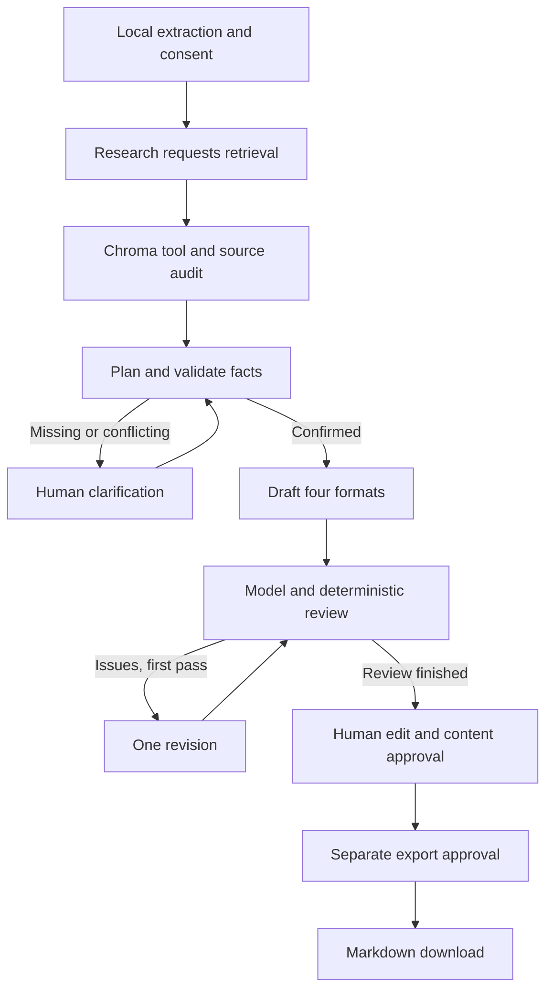

# LaunchPilot

**Turn a college-event brief and calendar into a campaign you can review, edit and approve.**

An independent implementation of **Project D — GTM Agent: Ideation to Copy**. LaunchPilot retrieves source evidence, plans a campaign, creates a LinkedIn post, promotional email, short blog and three ad variations, and sends the drafts through a separate review stage. A human decides what can be exported.

[Approved fictional sample](submission/SAMPLE_OUTPUT_FICTIONAL_APPROVED_v5.md) · [Project write-up](SUBMISSION.md) · [Architecture](FRAMEWORK.md) · [Demo script](submission/DEMO.md) · [Submission checklist](submission/CHECKLIST.md)

## What it does

- Reads a **text-based PDF or TXT brief** and **CSV event calendar**, with local extraction preview before consent.
- Uses a real LangChain retrieval-tool call over campaign-specific Chroma and local MiniLM embeddings.
- Plans the audience and tone, attaches source quotes to facts, and asks about missing or conflicting essentials.
- Drafts four coordinated formats with a common confirmed logistics block.
- Runs model and deterministic review, allows one automated revision, then hands control to a human.
- Saves checkpoints, questions, drafts, attempts and approvals across restarts.
- Requires **content approval and separate export approval** for a local Markdown download. Editing clears both approvals.

The application is local and single-user. It does not send emails, publish posts or run ad campaigns.

## See the result first

The [approved Northstar sample](submission/SAMPLE_OUTPUT_FICTIONAL_APPROVED_v5.md) contains all four formats, supporting facts and review history. Read it without an API key or running the app.

The demonstrated workflow used a **fictional event**, encountered connection failures, resumed the same saved campaign, and reached a human-edited, approved **version 5**. The model reviewer missed wording and eligibility issues that humans corrected.

| Recorded measure | Northstar campaign, 8 November 2026 |
|---|---|
| Provider attempts | 8: four failed, then four successful |
| Saved active processing | 41.485 seconds |
| Reported tokens | 8,494 across successful calls; failed-call usage unknown |
| Creation to final content approval | 48 minutes 59.449 seconds, including interruptions and human work |
| Final result | Four formats, three ad variations, separate content/export approvals |

One supervised fictional workflow is not an accuracy benchmark or evidence of audience results. [Full results and timing definitions](SUBMISSION.md#actual-results-for-this-campaign-only) · [Saved metrics](submission/CAMPAIGN_RESULTS.json).

## Run locally

### Requirements

- Python **3.11–3.13**; the commands below use 3.11.
- A Nebius API key with access to `openai/gpt-oss-120b` for generation.
- Internet access for dependencies, the initial embedding-model download and consented provider requests. Embeddings then run locally on CPU.

The recorded environment was Windows. Other platforms have not been independently verified for this submission. Model weights and dependencies can require substantial download space; they are excluded from Git.

### 1. Install — Windows Command Prompt

```cmd
git clone https://github.com/ghantaram4/LaunchPilot.git
cd LaunchPilot
py -3.11 -m venv .venv
.venv\Scripts\python.exe -m pip install -r requirements-lock.txt
.venv\Scripts\python.exe -m pip install --no-deps -e .
.venv\Scripts\python.exe -m launchpilot prepare-model
```

If you already have the project and its environment, open a terminal in that folder and skip installation. `requirements-lock.txt` records the verified environment's versions. Installing `-e ".[dev]"` instead resolves the ranges in `pyproject.toml` and may select different versions.

### 2. Configure credentials privately

Set the key in the **same terminal that will start Streamlit**:

```cmd
set "NEBIUS_API_KEY=YOUR_PRIVATE_KEY"
```

In PowerShell, use `$env:NEBIUS_API_KEY = 'YOUR_PRIVATE_KEY'` instead. Replace the placeholder privately; do not commit the key or include it in a recording.

Alternatively, copy [.env.example](.env.example) to an ignored `.env`, fill in its key privately, and explicitly point the app at it:

```cmd
copy .env.example .env
notepad .env
set "LAUNCHPILOT_CREDENTIAL_FILE=%CD%\.env"
```

**A local `.env` is not loaded automatically.** The app reads the environment first, then only the key's line from the configured credential file. A fresh clone does not need the earlier ReviewPilot project.

### 3. Start the app

```cmd
.venv\Scripts\python.exe -m streamlit run app.py --server.address 127.0.0.1 --server.port 8501
```

Open [http://127.0.0.1:8501](http://127.0.0.1:8501). Keep that terminal running. If port 8501 is occupied, check whether the app is already open; otherwise choose another port, such as 8502.

## Use a campaign

1. Upload a brief and calendar, or enable **Use the clearly labelled fictional demonstration**. The bundled demo uses Aster; the approved submission sample is the separate Northstar campaign.
2. Select one calendar row and inspect the locally extracted text.
3. Read the consent statement. **Create campaign and generate** sends scoped source context to Nebius, incurs paid requests and writes internal state.
4. Answer any missing/conflicting fact questions. If a stage fails, inspect the saved handoff and retry explicitly after resolving the cause; retries consume the same finite budget.
5. Review **LinkedIn, Email, Blog and Ad variations** against the evidence. Edit and save where needed.
6. Confirm human review, write a resolution note when required, and approve the current content version.
7. Separately approve export, then download the Markdown file.

Opening a saved campaign reuses stored progress. Saved edits increment the version and invalidate both approvals. Private campaign state is not bundled in the repository; a new clone starts with an empty campaign list.

### Input format

Use a UTF-8 calendar with these columns; `event_id` is optional:

```text
event_name,date,start_time,end_time,timezone,venue,price,registration_url,audience,tone
```

Use `YYYY-MM-DD`, 24-hour `HH:MM`, an IANA timezone such as `Asia/Kolkata`, a currency or `Free`, and an HTTPS registration URL. Matching `field: value` lines in the brief make facts easier to audit. Natural-language facts require verbatim supporting source quotes. Missing or ambiguous essentials require confirmation.

Limits: 5 MB per upload; PDFs must be unencrypted, text-based, at most 30 pages, with readable text on every page; brief text is limited to 65,000 characters. Calendars support 1–100 rows, with one selected event per campaign. There is no OCR or web validation of registration links.

Example inputs: [bundled brief](demo/FICTIONAL_event_brief.txt) and [calendar](demo/FICTIONAL_event_calendar.csv). The [Northstar extracted brief](submission/source_data/FICTIONAL_NORTHSTAR_BRIEF_EXTRACTED.txt) and [calendar](submission/source_data/FICTIONAL_NORTHSTAR_CALENDAR.csv) document the submitted sample; the extraction is not the original PDF.

## Architecture



LangGraph persists completed stages and interrupts in SQLite. Recoverable failures pause the failed stage for explicit retry. The revision loop runs at most once; unresolved issues remain for human disposition. Graph completion does not mean approval.

| Component | Responsibility |
|---|---|
| Streamlit / `app.py` | Uploads, consent, progress, editing, evidence and approvals |
| LangChain + LangGraph / `workflow.py` | Tool dispatch, planning, clarification, drafting, review and recovery |
| MiniLM + Chroma / `retrieval.py` | Local embeddings, persistent campaign-specific search, page/row metadata |
| `facts.py` + Pydantic models | Quote checks, fact validation, canonical logistics and output contracts |
| `provider.py` + `worker.py` | Nebius adapter, response cache, subprocess timeout, attempt/time ledger |
| `storage.py` + `service.py` | SQLite state, version guards, audit and approval-gated export |

Research supplies retrieval matches **and a full scoped source audit** before planning. This helps expose conflicting logistics but increases provider context. Source documents are treated as data; these boundaries do not establish general prompt-injection resistance. [Scope and acceptance criteria](FRAMEWORK.md).

## Configuration

| Setting | Actual behavior |
|---|---|
| Provider | Nebius, fixed `https://api.tokenfactory.nebius.com/v1/` |
| Generation model | `openai/gpt-oss-120b`, low reasoning, temperature 1 |
| Embeddings | `sentence-transformers/all-MiniLM-L6-v2`, CPU; tokenizer-aware chunks below 256 tokens |
| Limits per campaign | Eight provider attempts and 180 active seconds across stages/retries; human waiting excluded |
| Request handling | Killable worker; at most 40 seconds, capped by remaining time; SDK retries disabled |
| `NEBIUS_API_KEY` | Preferred credential source |
| `LAUNCHPILOT_CREDENTIAL_FILE` | Optional key-file path; historical fallback is `D:\ReviewPilot_VSCode_Backend\.env` |
| `LAUNCHPILOT_DATA_DIR` | Optional state root; default is the repository's ignored `data/` directory |

Eligible transient failures receive at most one automatic retry per provider call, subject to shared limits. Failed requests may still be billed; absent usage is unknown. The limits are not a dollar spending cap. An interrupted request with uncertain completion requires acknowledgement before a potentially duplicate charge. Successful responses are cached by stage/input hash; exactly-once charging cannot be guaranteed across every crash boundary.

## Persistence and retention

Campaign-managed uploads, vectors, application SQLite, LangGraph checkpoints, diagnostics and approvals expire **seven days after creation**. Cleanup runs on startup, before service operations and every five minutes while Streamlit runs. If the server is stopped, deletion waits until the next startup unless you schedule cleanup separately:

```cmd
.venv\Scripts\python.exe -m launchpilot cleanup
```

Downloads remain under the user's control. Deletion does not erase OS backups or guarantee forensic removal. The app uses a workspace-wide lock and has no multi-user authentication; bind it to localhost.

## Checks and troubleshooting

Prepare the embedding model first. Then, in Command Prompt:

```cmd
set "HF_HUB_OFFLINE=1"
set "TRANSFORMERS_OFFLINE=1"
.venv\Scripts\python.exe -m pytest
.venv\Scripts\python.exe -m ruff check .
```

Recorded verification comprised **31 offline application tests**, then **8 focused diagnostic tests** in a separate run. This documentation update did not rerun or combine those historical suites. They cover scripted provider behavior, local retrieval, persistence, handoffs, budgets and approvals; they do not establish general model accuracy. [Historical verification](VALIDATION.md) · [Live/offline scenario matrix](SUBMISSION.md#what-was-tested-live-offline-or-not-tested).

For a connection error, use a normal terminal and run the source-free probe:

```cmd
.venv\Scripts\python.exe -m launchpilot.diagnostics
```

It sends an unauthenticated HEAD, not a model request. An HTTP response confirms network/TLS reachability, not authentication. Future sanitized exception chains are retained in the campaign's `provider_diagnostics.jsonl`. The original Northstar failures lack those chains, so their exact historical cause remains unknown. Do not disable TLS or blindly retry.

## Submission materials and limits

- [SUBMISSION.md](SUBMISSION.md): overview, implementation, coding prompts/iterations, results and learnings; source for the required Google Doc.
- [DEMO.md](submission/DEMO.md): 4:40 recording script using saved results and labelled historical evidence.
- [Approved output](submission/SAMPLE_OUTPUT_FICTIONAL_APPROVED_v5.md) and [campaign results](submission/CAMPAIGN_RESULTS.json): unchanged evidence.
- [Delivery links](submission/DELIVERY_LINKS.json) and [checklist](submission/CHECKLIST.md): repository available; actual Google Doc and recording links still pending.

The model reviewer missed semantic issues in this campaign. Human correction was part of the result. Scope is one English, same-day college event; there is no OCR, audience analytics, localization, web fact-checking or production deployment. The sample demonstrates a supervised prototype, not guaranteed copy quality or campaign effectiveness.

The current repository-byte manifest is [GITHUB_FILES.sha256](submission/GITHUB_FILES.sha256). The [original packaging manifest](submission/archive/GITHUB_FILES_PACKAGING_20261108.sha256) is retained separately and does not describe this updated checkout. Git may convert line endings on Windows; current hashes refer to committed UTF-8/LF bytes. Private runtime data, credentials, caches, environments and local archives/recordings are ignored.
